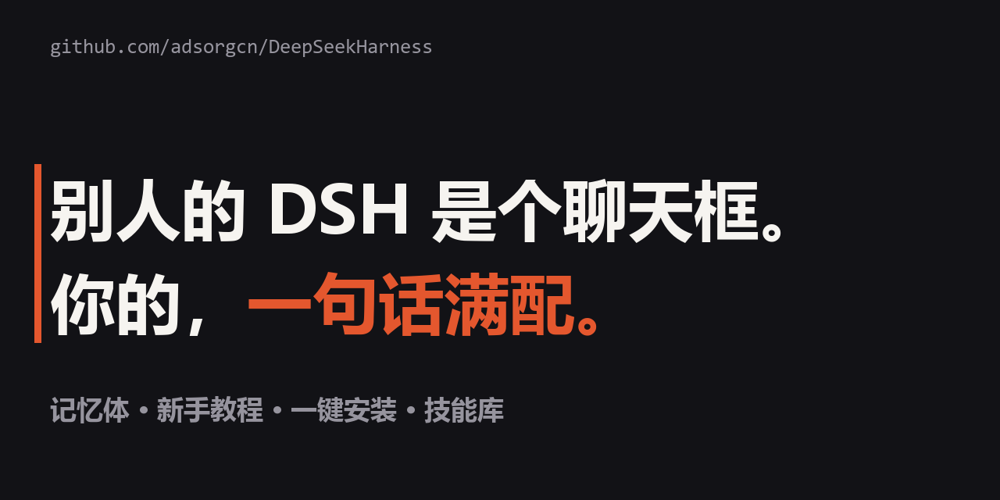

# DeepSeek Harness

**一句话，让你的 DSH 记住你、教会你、把环境装齐。**

## 开始（你只做这一件事）

在线门面：https://adsorgcn.github.io/DeepSeekHarness

把下面这句话，原样贴给你的 DSH：

> 帮我把 https://github.com/adsorgcn/DeepSeekHarness 装成本地 DSH 全套。缺什么软件你从官方装，要安装任何东西都先问我；装完告诉我，以后每个新窗口怎么一句话回到这里。

剩下的它全包：装环境（先问你再动手）、放好全套、问几个问题认识你。**你只粘贴、只点头。**

## 里面有什么

**记忆体** · 记住你的习惯、决定、规矩。换窗口、换电脑都不忘；每个新窗口开场，先汇报上次做到哪了。

**新手教程** · 从零开始玩 DSH。第一句就教你：先去学 iLang，学完再回来。

**一键安装** · 新电脑缺什么装什么。装任何东西前先问你，只走官方。

**技能库** · 好技能不断加进来。你刷到什么好东西，说一句「迭代进去」，它就进这个仓库。

## 以后每个新窗口

一句话：

> 进我的记忆体，看看上次到哪了。

或者把目录选成 DSH 的工作区，连这句话都不用说。

## 放心

笔记是纯文本，你随时能看、能改、能删。不传服务器，不记密码。

## 更新记录（每次改动即发版）

**v1.0.2** · 2026-11-05 · Issue 自动客服上线

- GitHub Actions 客服 bot：新 issue 与人工评论自动回复；以仓库文档为脑、新手人格为守则，不知道就说不知道，防循环、防刷屏

**v1.0.1** · 2026-11-05 · 版本纪律确立

- 三档版本规则：每次改动默认只动末位（patch）；owner 说「发中版」才动中间（minor）；owner 说「迭代大版本」才动前面（major）

**v1.0.0** · 2026-11-05 · 首发

- 记忆体：Mem-Forever 2.1 的 DSH 适配版（AGENTS.md 自动注入、技能挂载、brain.py 验收）
- 新手教程、插件点评、适配文档
- 一键安装：`bootstrap.ps1`（官方源安装 + 审批模式），环境、仓库、记忆一次到位
- 落地页：GitHub Pages，按 site-design-engine 工程书建成，独立评审修复后上线
- 技能：`mem-forever`、`site-design-engine`；官方 iLang 语法校验器随仓库发布
- 内置工作方式：索引寻址、可逆性裁决、注意力不平铺、iLang 交叉验证、cache_first

## 想看更多

- [dsh-新手起手式.md](dsh-新手起手式.md) · DSH 新手从零开始
- [一键安装.md](一键安装.md) · 装的时候发生了什么
- [插件点评-ilang视角.md](插件点评-ilang视角.md) · 现在的插件缺什么
- [ROADMAP.md](ROADMAP.md) · 这个仓库的迭代清单

基于 [iLang](https://ilang.ai) v5.0 与 [Mem-Forever](https://github.com/ilang-ai/Mem-Forever) · MIT
