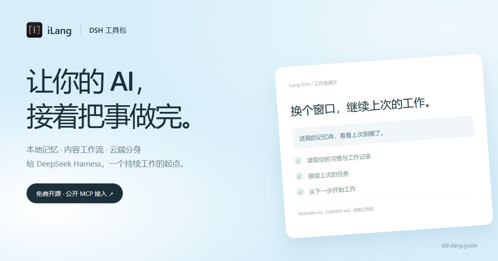

[](https://doi.org/10.5281/zenodo.23998664)
[](https://isitagentready.com/dsh.ilang.guide)

# iLang DSH 工具包

**别人的 DSH 是个聊天框。你的，一句话满配。**

> One sentence and your DeepSeek Harness remembers you. Memory · tutorial · one-click install · skills.

iLang 开发、面向 DeepSeek Harness 用户的开源工具包，提供本地记忆、新手教程、一键安装和技能库。

你只做三件事：选创造模式、粘贴、点头。

在线门面：https://dsh.ilang.guide/ （微信、QQ 里分享用下面的指导站地址）

指导站：https://ilang.cn/guide/dsh/ ——一页讲清贴哪句、会发生什么、怎么验收，Agent 可读的孪生在同一页；微信、QQ 里分享用这个地址。

## 那句话

新开一个任务，一定先选「创造模式」（装插件的工具只有它有，装不上东西时它能自己修），再把下面这句原样贴给它：

> 帮我把 https://github.com/adsorgcn/DeepSeekHarness 里的 iLang DSH 工具包安装到本地：先确认你现在是创造模式（手里有装插件的工具），不是就先别动手，让我新开一个任务、模式选「创造模式」再贴一遍；然后按我的系统下载并运行仓库里的 bootstrap.ps1（Windows）或 bootstrap.sh（macOS、Linux），打不开 GitHub 就从 https://gitee.com/monetize/DeepSeekHarness 取同名文件；它默认只检测，缺什么软件列给我，逐个征得我同意后再从官方源安装；装完再把官方插件 dsh-plugin-chuhai 装上（问我一次）；哪一步装不上或卡住，你自己想办法修好、装好再往下走，被权限拦了就向我申请一次放行；最后告诉我以后每个新窗口怎么一句话回到这里，还有「自媒体出海」这句话怎么用。

剩下它全包：装环境先问你再动手，放好全套，问几个问题认识你。Windows 走 bootstrap.ps1，macOS 与 Linux 走 bootstrap.sh，由 DSH 按系统选；软件只从官方源装；默认本机模式，什么都不上传。

连不上 GitHub：自动走国内镜像 gitee.com/monetize/DeepSeekHarness，iLang 官方资料自动走 ilang.cn。

在 DeepSeek Harness 0.2.2-rc.1 上验证（DSH 还是 Developer Preview，官方说可能有破坏性变更；装不上先看这一行）。

## 验收时刻

关掉窗口。重开。把那个文件夹选为工作区，什么都不说。它第一句就汇报上次做到哪。看到了，就是装好了。

## 里面有什么

**记忆体** · 窗口关了，进度还在。你的习惯、决定、规矩写成本地文件；换窗口不忘，换电脑贴一句「把我的记忆体备份到我自己的私有仓库」。每笔记忆 = 一次 git 提交，哈希链就是防伪链。

**新手教程** · 第一句，先学 iLang。教程不教你用 DSH：第一句让它去读 iLang 运行文件，读完用三句话告诉你学到了什么；第二句让它把你跑起来；第三句配模型，新手默认 deepseek-flash；第四句把灵魂写进去。四句话照抄，配模型、选协议、写人格全是它的活。

**一键安装** · 新电脑，一句话装齐。缺什么补什么，每步问你，只走官方源。可选免费全家桶：视频下载与视频转文字、笔记、语音，一件一审批。只装你点头同意的；删掉工作区项目文件就没了，另装的工具单独卸。

**技能库** · 好技能，随装随用。mem-forever、site-design-engine、deai、source-book 起步（deai：去 AI 味，像你自己写的；source-book：看见攻略，说一句「变工程书」，变成 AI 能照着执行的工程书），新技能持续进来；你刷到什么好东西，说一句「迭代进去」，它就进仓库。

## 市场

门是 iLang：清单过官方校验器 strict 0 错 0 警告。过了门、owner 说收的技能和工程书原样内置在工具包里，装了工具包就有，不用挑；货架在 https://dsh.ilang.guide/market/ 。第一本内置工程书：说一句「AI全球自媒体」。第二本：说一句「出片」，一句话或一张图，交给你的 Grok Bot 出图出视频，每一件成品都带着请求和判决。第三本：说一句「云端分身」，工作区进私有仓库，分身交给你的 Grok Bot，出门用手机说「出文」「出片」「发到 YouTube」。在别处看见不错的技能或插件，告诉你的 DSH，它帮你写一版更好的。想上货架先跑 tools/market_admit.py 自检再提申请，收录顺序就是显示顺序。

## 以后每个新窗口

> 进我的记忆体，看看上次到哪了。

或者把目录选成 DSH 的工作区，连这句话都不用说。

更新引擎：

> 把 iLang DSH 工具包的引擎更新到最新，不要动我的记忆。

看图：新手用 Flash，截图直接贴；说「认真想」才请 Pro。

视频转文字：贴链接或文件，出文字和字幕，本地跑，不上传。

## 放心

你的记忆，只在你的电脑上。笔记是纯文本，随时能看、能改、能删。出网的只有两件事：你向模型提问的 API 请求，和你主动配置的备份（自己的私有仓库或同步盘）。不记密码；钥匙在账本里，值静态编码，不是加密（见 [一键安装.md](一键安装.md)「钥匙放在账本里」）。工具包自己不设门：没有登录墙、没有许可证、不限次数、不看你在哪；模型那边说不，原话给你，下一句就是另一条路，不是一堵墙。

## 引用与致谢

本仓库站在公开学术工作之上，每一层都带 DOI / arXiv 锚点，作者有 ORCID 的挂 ORCID：

- iLang（[Long Quan Zhu](https://orcid.org/0009-0004-4540-8082)）：[DOI 10.5281/zenodo.21821452](https://doi.org/10.5281/zenodo.21821452)
- Mem-Forever（同作者）：[DOI 10.5281/zenodo.22865160](https://doi.org/10.5281/zenodo.22865160)
- DeepSeek-V4（DeepSeek-AI，arXiv 提交人 Wenfeng Liang）：[DOI 10.48550/arXiv.2606.19348](https://doi.org/10.48550/arXiv.2606.19348)

完整清单（R1 / V3 / SenseVoice / DSec 与标准组件）见 [docs/CITATIONS.md](docs/CITATIONS.md)。

## 想看更多

- [dsh-新手起手式.md](dsh-新手起手式.md) · 四句话，从零开始
- [一键安装.md](一键安装.md) · 装的时候发生了什么
- [CHANGELOG.md](CHANGELOG.md) · 更新记录，每次改动即发版
- [ROADMAP.md](ROADMAP.md) · 迭代清单
- [插件点评-ilang视角.md](插件点评-ilang视角.md) · 现在的插件缺什么

基于 [iLang](https://ilang.ai) v5.0 与 [Mem-Forever](https://github.com/ilang-ai/Mem-Forever) · MIT

## Agent 与 MCP 接入

**Agent Ready 100/100 · Level 5 Agent-Native** — 2026-11-17 默认 All Checks 实测。[查看完整结果 ↗](https://isitagentready.com/dsh.ilang.guide)

准备安装工具包时，让你的 Agent 先读官方安装说明；需要新能力时，让它查技能市场。公开只读，**无需账号、API Key 或令牌**。

在支持远程 MCP 的客户端中，新增服务器并填写：

| 接入项 | 设置 |
| --- | --- |
| 名称 | `ilang-dsh` |
| 地址 | `https://dsh.ilang.guide/mcp` |
| 传输方式 | Streamable HTTP |
| 认证方式 | 无（None） |

支持 `mcpServers` 格式的客户端，也可直接使用这段配置：

```json
{
  "mcpServers": {
    "ilang-dsh": {
      "url": "https://dsh.ilang.guide/mcp"
    }
  }
}
```

连接成功后，对 Agent 说：

> 读取 iLang DSH 的 Windows 安装说明，告诉我下一步需要确认什么。

将 Windows 换成 macOS 或 Linux，即可获取对应系统的指引。连接后可发现 5 个工具：产品概览、安装指引、文档检索、单篇文档读取和技能市场查询。安装由你的本地 Agent 按你的确认执行；这个公开服务不能访问本地记忆，也不会执行安装或发布。

- [接入说明与配置示例](https://dsh.ilang.guide/agents/)
- [OpenAPI](https://dsh.ilang.guide/openapi.json) · [Agent 导航](https://dsh.ilang.guide/llms.txt)
- [Agent Skills 索引](https://dsh.ilang.guide/.well-known/agent-skills/index.json) · [访问说明](https://dsh.ilang.guide/auth.md)

MCP 现可读取「变工程书」「出片」「云端分身」及其随包执行正文，共 20 项固定公开资源、5 个只读工具。它返回使用资料，制作、同步和发布仍由你的 Agent 按实际配置与授权执行。

支持 WebMCP 的浏览器还可在首页调用「读取安装说明」和「搜索技能市场」。安装仍由本地 Agent 按用户确认执行。

认证发现声明明确标为未启用；发现项通过不表示提供了登录或令牌服务。
